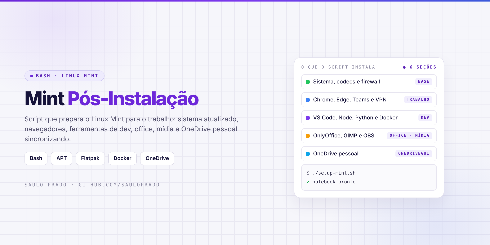
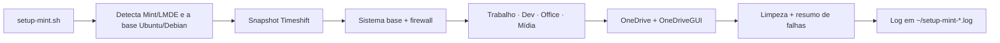

<p align="center">

</p>

<h1 align="center">Mint Pós-Instalação</h1>
<p align="center"><i>Script que prepara o Linux Mint para o trabalho com um único comando: sistema, navegadores, dev, office, mídia e OneDrive pessoal</i></p>

<p align="center">


</p>

## Sumário

- [Sobre](#sobre)
- [O que o script instala](#o-que-o-script-instala)
- [Como funciona](#como-funciona)
- [Como executar](#como-executar)
- [OneDrive pessoal no Linux](#onedrive-pessoal-no-linux)
- [Depois da instalação](#depois-da-instalação)
- [Estrutura do repositório](#estrutura-do-repositório)
- [Projetos irmãos](#projetos-irmãos)
- [Créditos](#créditos)
- [Autor](#autor)

## Sobre

Automação em **Bash** para deixar um notebook com Linux Mint pronto para o trabalho logo depois da instalação, sem configurar nada na mão. O script é dividido em seções, pergunta antes de cada uma (ou instala tudo com `--tudo`), usa sempre os **repositórios oficiais** de cada fabricante, continua mesmo se um item falhar e mostra no final o resumo do que deu certo e do que precisa de atenção.

Compatível com **Linux Mint 22.x** (base Ubuntu 24.04) e **LMDE 6/7** (base Debian).

## O que o script instala

| Seção | Na prática | Origem |
| --- | --- | --- |
| 🛟 Restauração | Snapshot do Timeshift antes de qualquer mudança | Timeshift |
| 🧱 Sistema base | Atualização completa, codecs, utilitários (git, htop, btop, 7zip, gparted), fontes para código e firewall ativado | APT · ufw |
| 💼 Trabalho | Google Chrome, Microsoft Edge, Teams for Linux, Remmina (RDP/VNC), AnyDesk e plugins de VPN (OpenVPN, OpenConnect, WireGuard) | Repositórios oficiais · Flathub |
| 💻 Desenvolvimento | VS Code, Git configurado, GitHub CLI, Python (pip, venv, pipx), Node.js LTS via nvm, Docker + Compose, DBeaver, Postman e Claude Code (opcional) | Repositórios oficiais · Flathub |
| 📄 Produtividade | Fontes Microsoft, OnlyOffice (compatível com .docx/.xlsx/.pptx), Flameshot e Obsidian | APT · Flathub |
| 🎬 Mídia | VLC, GIMP, Inkscape, OBS Studio e Kdenlive | APT · Flathub |
| ☁️ OneDrive | Cliente OneDrive com interface gráfica, sincronizando uma pasta local como no Windows | onedrive (abraunegg) + OneDriveGUI |

## Como funciona



## Como executar

```bash
git clone https://github.com/sauloprado/mint-pos-instalacao.git
cd mint-pos-instalacao
chmod +x setup-mint.sh

# pergunta seção por seção (Enter = Sim)
./setup-mint.sh

# instala tudo sem perguntar
./setup-mint.sh --tudo
```

> Rode como seu usuário normal, **sem `sudo`**: o script pede a senha só quando precisa instalar pacotes. Tudo fica registrado em `~/setup-mint-AAAAMMDD-HHMM.log`.

## OneDrive pessoal no Linux

A Microsoft não tem app oficial do OneDrive para Linux. O script instala o cliente open source [onedrive](https://github.com/abraunegg/onedrive) pelo repositório recomendado pelo próprio projeto (OpenSUSE Build Service), remove versões antigas dos repositórios do Ubuntu e instala a interface gráfica [OneDriveGUI](https://github.com/bpozdena/OneDriveGUI) (AppImage) com atalho no menu.

Para conectar a conta depois de reiniciar:

1. Abra **OneDrive (OneDriveGUI)** no menu e clique em **Add profile**.
2. Clique em **Sign in with web browser** e entre com sua conta Microsoft pessoal.
3. Escolha a pasta local (ex.: `~/OneDrive`).
4. Em **Settings**, marque a opção de iniciar com o sistema.

> Use só o OneDriveGUI. Não ative também o serviço `systemctl --user enable onedrive`, porque os dois juntos entram em conflito.

## Depois da instalação

| Passo | Como |
| --- | --- |
| Reiniciar | Necessário para o Docker funcionar sem `sudo` e os apps Flatpak aparecerem no menu |
| Drivers | Menu → **Gerenciador de drivers** (placa de vídeo e Wi-Fi proprietários) |
| Outlook, Teams e To Do como apps | No Edge: menu **…** → **Aplicativos** → **Instalar este site como aplicativo** |
| Testar Node | Terminal novo → `node -v` |
| Testar Docker | `docker run hello-world` |

## Estrutura do repositório

```text
mint-pos-instalacao/
├── setup-mint.sh # script completo (pergunta por seção | --tudo)
├── assets/
│   └── capa.png
├── LICENSE
└── README.md
```

## Projetos irmãos

| Projeto | O que faz |
| --- | --- |
| [mint-estilo-mac](https://github.com/sauloprado/mint-estilo-mac) | Visual de macOS no Linux Mint (Cinnamon) |
| [ubuntu-estilo-mac](https://github.com/sauloprado/ubuntu-estilo-mac) | Visual de macOS no Ubuntu (GNOME) |
| [fedora-estilo-mac](https://github.com/sauloprado/fedora-estilo-mac) | Visual de macOS no Fedora (GNOME) |

## Créditos

Cliente OneDrive: [abraunegg/onedrive](https://github.com/abraunegg/onedrive). Interface gráfica: [bpozdena/OneDriveGUI](https://github.com/bpozdena/OneDriveGUI). Teams for Linux: [IsmaelMartinez/teams-for-linux](https://github.com/IsmaelMartinez/teams-for-linux). Todos os programas são baixados direto das fontes oficiais durante a execução; nada é redistribuído aqui.

Projeto pessoal, sem vínculo com Microsoft, Google ou Linux Mint. Os nomes citados são marcas de seus respectivos donos.

## Autor

**Saulo Prado** · Analista de Sistemas · Gestão de Ativos de TI, orçamento, automação e dashboards

[](https://www.linkedin.com/in/saulo-prado-ab4a0b96/)
[](https://github.com/sauloprado)
